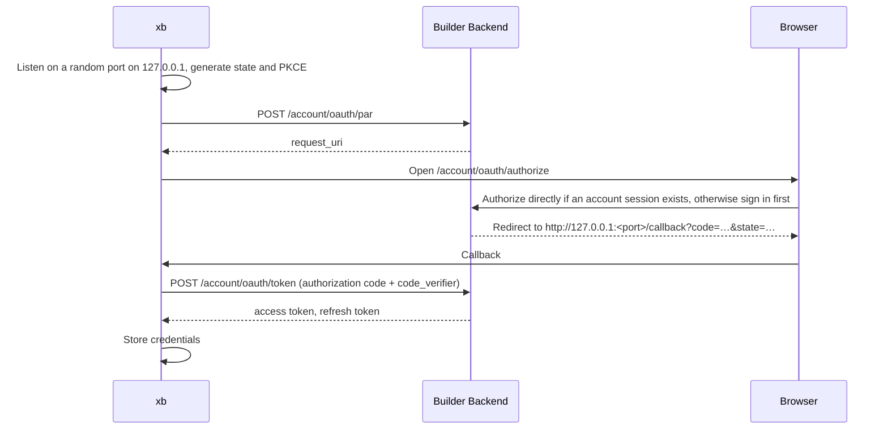

# Design: xb sign-in and environments (draft)

中文版：[auth.zh.md](./auth.zh.md)

This document defines how `xb auth` signs in, how credentials are stored, and how multiple environments are supported. Account-side rules follow [XBuilder Account app registration and integration](https://github.com/goplus/builder/blob/dev/docs/product/account-app-integration.zh.md) in goplus/builder.

## Scope

- Sign in to an XBuilder account through the browser. Tokens are stored on the machine and refreshed automatically
- Stay signed in to several environments at once (global production, China production, staging, and environments the user adds), with more than one account per environment
- Sign in with an access token issued by an administrator, for cases where browser sign-in is not possible
- Switch between signed-in sessions

## Sign-in flow

`xb` is a public OAuth client under the xbuilder app. It uses the authorization code grant with PKCE, the same way the XBuilder web app signs in. The product API accepts user tokens issued to any client under the xbuilder app, so a signed-in `xb` can call the project and course APIs directly.



Parameters of each step:

| Step | Request |
| - | - |
| PAR | `response_type=code`, `client_id`, `redirect_uri`, `state`, `code_challenge`, `code_challenge_method=S256`, `scope=account:user:read` |
| Authorize | `GET /account/oauth/authorize?client_id=…&request_uri=…` |
| Token | `grant_type=authorization_code`, `client_id`, `redirect_uri`, `code`, `code_verifier` |
| Refresh | `grant_type=refresh_token`, `client_id`, `refresh_token` |
| Sign out | `POST /account/oauth/revoke` with `client_id` and the refresh token |

All endpoints are under the environment's API URL. The backend supplies the sign-in page URL in its redirect, so `xb` does not need to know it.

The callback must verify `state`. The local listener accepts one callback, responds with a page saying the tab can be closed, and shuts down.

Sign-in has two time limits:

- The `request_uri` returned by PAR is valid for 10 minutes and must be used to open the authorize page before it expires
- `xb` waits for the callback for at most 15 minutes after printing the authorize URL, then fails

## Signing in with a token

`xb auth login --with-token` creates a session from an existing access token without going through the browser. It is for cases where the browser is not on the same machine (SSH, cloud sandboxes, CI).

An account administrator issues the token in the admin console for a user's grant on the xbuilder app:

- The expiry time is set when the token is issued, at most 365 days ahead
- It is an access token only, with no refresh token. After it expires, a new token has to be issued and the user signs in again
- The client chosen when issuing does not have to be `cli`. A token issued to any client under the xbuilder app works

The token is not passed as a command-line argument, so it stays out of shell history and the process list. How `xb` gets the environment and the token depends on whether standard input is a terminal:

- When standard input is a terminal, `xb` is interactive. Without `--env` it lists the built-in environments and the ones the user has added, and the user picks one. An API URL cannot be typed in at this point. It then prompts for the token and does not echo the input
- When standard input is not a terminal (a pipe, CI, an agent), `xb` shows no prompt and reads one line as the token. The environment is chosen the same way as for browser sign-in (see "Commands")

With the environment and the token:

1. `xb` requests `GET /user` with the token. On success it gets the username. On failure it reports an error and creates no session
2. It creates the session `<username>@<environment>` and stores the token. The new session becomes the current session
3. It prints the name of the session

A token session differs from a browser session in these ways:

- It is never refreshed and does not use the refresh lock
- `xb` cannot know when the token expires: the token is opaque, and the introspection endpoint is only open to confidential clients. When the API returns 401, `xb` deletes the session's credentials, marks the session as expired, and fails with an authentication error
- `xb auth logout` only deletes the local credentials and does not revoke the token: the revoke endpoint only accepts tokens issued to the requesting client, and this token may have been issued to another client. To invalidate the token, an administrator revokes it in the admin console

Such a token is long-lived and stays usable after a leak until it expires or is revoked. Use browser sign-in whenever it is possible.

## Required backend change

The backend currently matches redirect URIs as whole strings, port included. `xb` listens on a different port each time, so the backend needs to relax matching as described in [RFC 8252 section 7.3](https://www.rfc-editor.org/rfc/rfc8252.html#section-7.3):

- When a registered redirect URI uses `http` and its host is a loopback IP (`127.0.0.1` or `[::1]`), the port is ignored when matching the requested redirect URI. Everything else is still matched exactly
- `localhost` and all other hosts are unaffected
- The authorization code still records the full redirect URI used in the request, and the token request still compares it verbatim

The change is in `internal/account/auth_flow_service.go` (`clientAllowsRedirectURI`) in builder-backend. The account product and technical documents in goplus/builder need the matching update where they describe exact redirect URI matching.

An account administrator also registers one client under the xbuilder app in each environment:

| Field | Value |
| - | - |
| Name | `cli` |
| Type | public |
| Grant types | `authorization_code`, `refresh_token` |
| Redirect URI | `http://127.0.0.1/callback` |

## Environments

Accounts, projects, and courses are separate in each environment. `xb` needs two settings per environment: the API URL and the `clientID` that environment assigned to the `cli` client. Each environment generates its own random `clientID`. It is not a secret.

Built-in environments:

| Name | API URL | `clientID` of `cli` |
| - | - | - |
| `xbuilder.com` | `https://api.xbuilder.com` | not registered |
| `x.qiniu.com` | `https://xbuilder-api.qiniu.com` | not registered |
| `staging` | `https://goplus-builder-api.qiniu.io` | `gG3y-EFitDAw292NrUjQMQ` |

Users add other environments (temporary test environments, a local backend). They are saved in the user configuration:

```
xb env add <name> --api-url <API URL> --client-id <clientID>
xb env list [--json]
xb env remove <name>
```

`xb env list` lists the built-in environments and the ones the user has added. For each it gives the name, the API URL, whether it is built in, and its sessions. It reads only local configuration and does not access the network. Output of `--json`:

```json
{
  "environments": [
    {
      "name": "staging",
      "apiURL": "https://goplus-builder-api.qiniu.io",
      "builtin": true,
      "sessions": ["curator@staging"]
    }
  ]
}
```

Constraints on `xb env add`:

- An environment name consists of lowercase letters, digits, `.`, `_`, and `-`, and starts with a letter or digit
- `--api-url` must use `https`. `http` is allowed when the host is `127.0.0.1`, `[::1]`, or `localhost`, for a local backend

## Sessions

A session is an environment plus one account signed in to it. Its name is `<username>@<environment>`, for example `curator@staging`. An environment can have several sessions, one per account.

XBuilder usernames contain only letters, digits, `_`, and `-`. If the backend returns a username that does not follow this rule, `xb auth login` fails and creates no session.

`xb` keeps one current session. A successful `xb auth login` makes the new session current. `xb auth switch` changes the current session.

Which session a command uses:

1. The session given by `--session <name>`
2. Inside a project directory, only sessions of the project's environment (see below): the current session if it belongs to that environment; otherwise the only session of that environment; otherwise the command fails and lists the sessions of that environment
3. Otherwise the current session
4. With no current session, the command fails and lists the existing sessions

There is no implicit default environment. Production has a global and a China deployment, and a wrong guess would sign in to the other one.

The authorize page has no confirmation step: `xb auth login` gets a session for whichever account the browser is signed in to on the account site. To sign in a second account in the same environment, switch accounts in the browser first. `xb auth login` prints the name of the session it created.

### Project directory

`xb clone` and `xb new` write `.xb/config.json` at the project root, recording the name of the project's environment. `xb push` and `xb pull` then only talk to that environment. `xb push` does not upload `.xb/`. The rest of this file (project owner and name, last synced cloud version) is defined in the design of the project commands.

A project directory may come from someone else, so `.xb/config.json` is untrusted:

- It records only the environment name, never an API URL or a `clientID`
- The name is looked up only in the built-in environments and the user configuration. If it is not found, the command fails. No environment is added automatically
- The design of the project commands must not add fields to this file that change where requests are sent

The same course has a different course ID in each environment. The mapping between a local directory and a course on the platform is recorded per environment.

## Credential storage

The credentials of a browser session are the refresh token, the access token, and the access token's expiry time. The credentials of a token session are that one access token. Both are stored the same way.

By default credentials are kept in the system credential store, one entry per session: macOS Keychain, Windows Credential Manager, or the Linux Secret Service. If writing to the credential store fails at sign-in (no desktop session, not reachable from a sandbox), `xb` saves the credentials to a file instead and says so on standard error.

Rules for credential files:

- Files are under `xb/credentials/` in the user configuration directory, one per session. Only the owner can access the directory
- The file name is the hex encoding of the session name, not the session name itself. Lock files under `xb/locks/` are named the same way
- Only the owner can read and write a file. A write creates a temporary file in the same directory with owner-only permissions, then renames it over the target
- On Windows an owner-only ACL gives the same effect

`xb/config.json` in the user configuration directory holds what is not secret: user-added environments, the session list (name, environment, username, sign-in method, storage location, whether it has expired), and the current session. A change to this file takes the file's lock, re-reads the file, applies the change, and replaces the file by writing a temporary file and renaming it. No network access happens while this lock is held.

If a session's credentials are in the credential store and the store is not reachable at run time (for example, signed in on the desktop and running commands in a sandbox), the command fails with an authentication error and asks the user to sign in again.

An access token lasts 5 minutes. A refresh token lasts 30 days, counted again from each refresh. A refresh token can be used once: if an old one is used again, the backend revokes every token of that sign-in. Agents often run several `xb` commands at once, so refreshes must be serialized:

1. Read the credentials. If the access token has more than 30 seconds left, use it
2. Otherwise take an exclusive lock on the session's lock file. Lock files are under `xb/locks/` in the user configuration directory and are used whether the credentials are in the credential store or in a file
3. With the lock held, read the credentials again. If another process has already refreshed them, use them
4. Refresh with the refresh token, write the credentials back, and release the lock

Locks are operating system file locks (`flock`, `LockFileEx`), released automatically when the process exits. The existence of a lock file does not mean it is locked. `xb` waits at most 30 seconds for the lock and at most 15 seconds for the refresh request. On timeout it exits with an error and leaves the credentials unchanged.

If the process is killed after the backend handled the refresh but before the credentials were written, the local refresh token is no longer valid and the user has to sign in again. This case gets no special handling.

When a refresh returns `invalid_grant` (the token expired or was revoked), `xb` deletes the session's credentials, marks the session as expired in `xb/config.json`, and fails with an authentication error. The session stays in the list and is restored by signing in again.

## Commands

| Command | Behavior |
| - | - |
| `xb auth login [--env <name>] [--no-browser]` | Signs in and creates a session, which becomes the current session. Opens the browser by default and also prints the authorize URL to standard error. `--no-browser` only prints the URL |
| `xb auth login --with-token [--env <name>]` | Creates a session from an access token, which becomes the current session. Does not open the browser. In a terminal it prompts for the environment and the token. Otherwise it reads the token from standard input |
| `xb auth status [--json]` | Lists all sessions: name, environment, username, sign-in method, whether it is current, whether it has expired, and where its credentials are stored |
| `xb auth switch <session>` | Makes the given session current |
| `xb auth logout [<session>]` | Deletes the local credentials and the session. Defaults to the current session. For a browser session it first revokes the refresh token. If the revoke request fails, the local data is still deleted and a notice is printed. After signing out of the current session there is no current session |

When `--env` is omitted, `xb auth login` picks the environment in this order (except in the interactive mode of `--with-token`, where the user picks it):

1. Inside a project directory, the project's environment
2. Otherwise the environment of the current session
3. With no current session, it fails, asks for `--env`, and lists the available environment names:

```
error: --env is required
available environments: xbuilder.com, x.qiniu.com, staging
run: xb auth login --env <name>
```

When the resulting session already exists, its credentials are replaced:

- After the new credentials are saved, the old refresh token is revoked (when the old session was a browser session). A failed revoke prints a notice and does not affect the sign-in
- If the old and new credentials are stored in different places (credential store and file), the old copy is deleted

`xb auth status` reads only `xb/config.json`. It does not read credentials, refresh tokens, or access the network. It therefore does not show a refresh token that expired after 30 days without use. That session is marked as expired the next time it is used.

`xb auth login` is the only command that needs a person. Browser sign-in waits for the browser callback and does not read from the terminal. The interactive mode of `--with-token` is the only interactive input in `xb`, and it appears only when standard input is a terminal. `xb auth switch` has no interactive picker and requires a session name. Other commands never start a sign-in when no session is usable or the credentials have expired. They exit with the authentication error code, and the message gives the command to run, for example:

```
error: session curator@staging has expired
run: xb auth login --env staging
```

Output of `xb auth status --json`:

```json
{
  "sessions": [
    {
      "name": "curator@staging",
      "environment": "staging",
      "apiURL": "https://goplus-builder-api.qiniu.io",
      "username": "curator",
      "method": "browser",
      "current": true,
      "signedIn": true,
      "storage": "keychain"
    }
  ]
}
```

`method` is `browser` or `token`. `signedIn` is `false` when the session is marked as expired. `storage` is `keychain` or `file`.

## Changes to the README

- Describe `xb auth login` as browser sign-in with a loopback callback instead of device code
- Keep `xb auth login --with-token`. Add where the token comes from and how the environment is chosen
- Remove the description of `XB_TOKEN`. Add the file fallback to the description of the system keychain
- Add environments and sessions, the `xb env` and `xb auth switch` commands, and the `--session` flag. Say that `xb env list` shows the available environment names

## Verification

On staging:

1. After the backend change is merged and deployed, register the `cli` client
2. `xb auth login --env staging` signs in, `xb auth status` shows the session, and the credentials are in the system credential store
3. After the access token expires, run several authenticated commands at once. All succeed and the session is still signed in afterwards
4. Switch accounts in the browser and sign in again to get a second session. Both `xb auth switch` and `--session` make commands run as the corresponding account
5. Sign in where the credential store is not reachable. The credentials are saved to a file, and step 3 passes there too
6. After `xb auth logout`, the old refresh token can no longer be used to refresh
7. Running an authenticated command with no usable session gives the authentication error code and message
8. Issue an access token in the admin console. Sign in with `xb auth login --with-token` once interactively in a terminal and once through a pipe. Commands work after each. After the token is revoked in the admin console, the next command marks the session as expired

## Open questions

- Names of the built-in environments
- On macOS an unsigned `xb` triggers a keychain prompt on first access after each upgrade. Whether to sign releases
