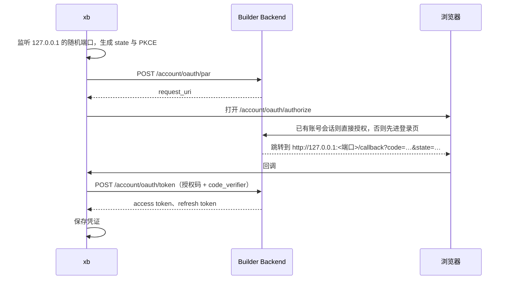

# xb 登录与多环境设计（草稿）

English version: [auth.md](./auth.md)

本文定义 `xb auth` 的登录方式、凭证保存和多环境支持。账号侧的规则以 goplus/builder 的 [XBuilder Account 自有 app 登记与接入](https://github.com/goplus/builder/blob/dev/docs/product/account-app-integration.zh.md) 为准。

## 范围

- 通过浏览器登录 XBuilder 账号，令牌保存在本机并自动续期
- 同时登录多个环境（线上海外、线上国内、staging，以及自行添加的环境），同一个环境可以登录多个账号
- 用管理员签发的 access token 登录，供不能使用浏览器登录的场合使用
- 在已登录的会话之间切换

## 登录流程

`xb` 作为 xbuilder 这个 app 下的一个 public OAuth client 接入，使用授权码加 PKCE，和 XBuilder 网页的登录方式相同。产品 API 接受 xbuilder app 下任意 client 签发的用户令牌，所以登录后可以直接调用项目、课程等接口。



各步的参数：

| 步骤 | 请求 |
| - | - |
| PAR | `response_type=code`、`client_id`、`redirect_uri`、`state`、`code_challenge`、`code_challenge_method=S256`、`scope=account:user:read` |
| 授权 | `GET /account/oauth/authorize?client_id=…&request_uri=…` |
| 换令牌 | `grant_type=authorization_code`、`client_id`、`redirect_uri`、`code`、`code_verifier` |
| 续期 | `grant_type=refresh_token`、`client_id`、`refresh_token` |
| 退出 | `POST /account/oauth/revoke`，传 `client_id` 和 refresh token |

所有接口都在环境的后端地址下，登录页地址由后端在跳转中给出，`xb` 不需要知道。

回调必须校验 `state`。本机监听只接受一次回调，收到后给浏览器返回一个"可以关闭此页面"的页面并立即关闭。

登录有两个时限：

- PAR 返回的 `request_uri` 有效期 10 分钟，必须在此之前用它打开授权页
- `xb` 从打印授权地址起最多等待回调 15 分钟，超时则登录失败

## 用令牌登录

`xb auth login --with-token` 不经过浏览器，直接用一个已有的 access token 建立会话。它用于浏览器不在同一台机器上的场合（SSH、云端沙箱、CI）。

令牌由账号管理员在管理后台为某个用户对 xbuilder app 的授权签发：

- 签发时指定到期时间，最长 365 天
- 只有 access token，没有 refresh token，到期后需要重新签发并重新登录
- 签发时选择的 client 不限于 `cli`，xbuilder app 下任意 client 签发的令牌都可以使用

令牌不通过命令行参数传入，以免留在 shell 历史和进程列表里。`xb` 按标准输入是否为终端决定怎样取得环境和令牌：

- 标准输入是终端时进入交互模式。没有 `--env` 时列出内置环境和用户已添加的环境供选择，不能当场输入后端地址；然后提示输入令牌，输入不回显
- 标准输入不是终端（管道、CI、agent）时不显示任何提示，直接读取一行作为令牌。环境的选择规则和浏览器登录相同（见"命令"）

取得环境和令牌之后：

1. 用这个令牌请求 `GET /user`，成功则得到用户名，失败则报错，不创建会话
2. 创建会话 `<用户名>@<环境名>` 并保存令牌，新会话成为当前会话
3. 打印得到的会话名

用令牌登录的会话与浏览器登录的会话有以下区别：

- 不续期，也不使用续期的锁
- `xb` 无法得知令牌的到期时间：令牌不透明，而查询令牌状态的接口只对 confidential client 开放。接口返回 401 时，`xb` 删除该会话的凭证，把会话标为已失效，并按认证错误报错
- `xb auth logout` 只删除本地凭证，不撤销令牌：撤销接口只接受签发给请求方 client 的令牌，而这个令牌可能签发给别的 client。需要作废令牌时，由管理员在管理后台撤销

这种令牌有效期长，泄露后在到期或被撤销前一直可用。能用浏览器登录时应使用浏览器登录。

## 依赖的后端改动

后端现在要求回调地址整串一致，端口也算在内。`xb` 每次监听的端口不固定，因此需要后端按 [RFC 8252 第 7.3 节](https://www.rfc-editor.org/rfc/rfc8252.html#section-7.3)放开：

- 登记的回调是 `http` 且主机为回环 IP（`127.0.0.1` 或 `[::1]`）时，匹配请求中的回调地址不比较端口，其余部分仍精确匹配
- `localhost` 和其他地址不受影响
- 授权码仍保存请求实际使用的完整回调地址，换令牌时逐字比较，这部分不变

改动位置在 builder-backend 的 `internal/account/auth_flow_service.go`（`clientAllowsRedirectURI`），同时更新 goplus/builder 的账号产品文档和技术文档中关于回调精确匹配的描述。

每个环境还需要账号管理员在 xbuilder app 下登记一个 client：

| 项 | 值 |
| - | - |
| 名称 | `cli` |
| 类型 | public |
| 授权方式 | `authorization_code`、`refresh_token` |
| 回调地址 | `http://127.0.0.1/callback` |

## 环境

各环境的账号、项目和课程互相独立。`xb` 对每个环境只需要两项配置：后端地址和该环境分配给 `cli` client 的 `clientID`。`clientID` 由各环境随机生成，互不相同，不属于机密。

内置环境：

| 名称 | 后端地址 | `cli` 的 clientID |
| - | - | - |
| `xbuilder.com` | `https://api.xbuilder.com` | 未登记 |
| `x.qiniu.com` | `https://xbuilder-api.qiniu.com` | 未登记 |
| `staging` | `https://goplus-builder-api.qiniu.io` | `gG3y-EFitDAw292NrUjQMQ` |

其他环境（临时测试环境、本机后端）由用户添加，保存在用户配置里：

```
xb env add <名称> --api-url <后端地址> --client-id <clientID>
xb env list [--json]
xb env remove <名称>
```

`xb env list` 列出内置环境和用户添加的环境，每个环境给出名称、后端地址、是否内置、已有的会话。它只读取本地配置，不访问网络。`--json` 的输出：

```json
{
  "environments": [
    {
      "name": "staging",
      "apiURL": "https://goplus-builder-api.qiniu.io",
      "builtin": true,
      "sessions": ["curator@staging"]
    }
  ]
}
```

`xb env add` 的约束：

- 环境名称只能由小写字母、数字、`.`、`_`、`-` 组成，并以字母或数字开头
- `--api-url` 必须是 `https`。主机为 `127.0.0.1`、`[::1]`、`localhost` 时可以是 `http`，用于连接本机后端

## 会话

一个会话是一个环境加上在该环境登录的一个账号，名称为 `<用户名>@<环境名>`，例如 `curator@staging`。同一个环境可以有多个会话，对应不同账号。

XBuilder 的用户名只包含字母、数字、`_`、`-`。后端返回的用户名不符合这个规则时，`xb auth login` 报错，不创建会话。

`xb` 记录一个当前会话。`xb auth login` 成功后，新会话成为当前会话；`xb auth switch` 改变当前会话。

命令使用哪个会话：

1. 命令带 `--session <名称>` 时使用它
2. 在项目目录内时，只使用项目所属环境的会话（见下）：当前会话属于该环境则使用它；否则该环境只有一个会话时使用它；否则报错，并列出该环境的会话
3. 其他情况使用当前会话
4. 没有当前会话时报错，并列出已有的会话

不设隐含的默认环境。线上有海外和国内两套，猜错会登录到另一套账号。

授权页没有确认步骤：浏览器在账号页登录着哪个账号，`xb auth login` 得到的就是哪个账号的会话。在同一个环境登录第二个账号前，需要先在浏览器的账号页换好账号。`xb auth login` 完成后打印得到的会话名。

### 项目目录

`xb clone`、`xb new` 在项目根目录写入 `.xb/config.json`，其中记录项目所属环境的名称。之后 `xb push`、`xb pull` 只访问该环境。`xb push` 不上传 `.xb/`。这个文件的其余内容（项目所有者与名称、上次同步的云端版本）在项目命令的设计里定义。

项目目录可能来自他人，`.xb/config.json` 的内容不可信：

- 文件里只记录环境的名称，不记录后端地址和 `clientID`
- 环境名称只在内置环境和用户配置里查找，找不到时报错，不会自动添加环境
- 项目命令的设计不能往这个文件里加入会改变请求目标的字段

同一门课在不同环境的课程 ID 不同，本地目录与平台课程的对应关系按环境分别记录。

## 凭证保存

浏览器登录的会话，凭证包括 refresh token、access token 及其到期时间。用令牌登录的会话，凭证只有那个 access token。两种凭证的保存方式相同。

凭证默认保存在系统的凭据存储里，每个会话一个条目：macOS 钥匙串、Windows 凭据管理器、Linux Secret Service。登录时写入凭据存储失败（没有桌面会话、沙箱中不可访问）则改为保存成文件，并在标准错误提示。

凭证文件的规则：

- 文件在用户配置目录的 `xb/credentials/` 下，每个会话一个。该目录仅本人可访问
- 文件名是会话名的十六进制编码，不直接使用会话名。`xb/locks/` 下的锁文件相同
- 文件仅本人可读写。写入时在同一目录下以仅本人可读写的权限新建临时文件，写完后改名替换
- Windows 上用仅本人可访问的 ACL 达到相同效果

用户配置目录的 `xb/config.json` 保存不属于机密的内容：自行添加的环境、会话列表（名称、环境、用户名、登录方式、凭证存放位置、是否已失效）和当前会话。修改这个文件时先取得它的锁，重新读取后再修改，以写临时文件再改名的方式替换。持有这把锁期间不访问网络。

会话的凭证在凭据存储里、而运行时凭据存储不可访问（例如在桌面登录，在沙箱里运行命令）时，按认证错误处理，提示重新登录。

access token 有效期 5 分钟，refresh token 30 天，每次续期后重新计 30 天。refresh token 只能使用一次：旧的被再次使用时，后端会撤销这次登录的全部令牌。agent 经常同时运行多条 `xb` 命令，因此续期必须串行：

1. 读取凭证，access token 距到期超过 30 秒则直接使用
2. 否则对该会话的锁文件加排他锁。锁文件在用户配置目录的 `xb/locks/` 下，凭证存在凭据存储还是文件里都用它
3. 拿到锁后重新读取凭证，其他进程已经续期则直接使用
4. 用 refresh token 续期并写回凭证，然后释放锁

锁使用操作系统提供的文件锁（`flock`、`LockFileEx`），进程退出时自动释放，不以锁文件是否存在作为判断。等待锁最多 30 秒，续期请求最多 15 秒，超时则以错误退出，不改动凭证。

续期请求已被后端处理、但本地写入前进程被终止时，本地的 refresh token 已作废，需要重新登录。这种情况不另做处理。

续期返回 `invalid_grant`（令牌过期、被撤销）时，删除该会话的凭证，在 `xb/config.json` 里把会话标为已失效，并按认证错误报错。会话仍留在列表里，重新登录后恢复。

## 命令

| 命令 | 行为 |
| - | - |
| `xb auth login [--env <名称>] [--no-browser]` | 登录并创建会话，新会话成为当前会话。默认打开浏览器，同时把授权地址打印到标准错误；`--no-browser` 只打印地址 |
| `xb auth login --with-token [--env <名称>]` | 用 access token 创建会话，新会话成为当前会话。不打开浏览器。在终端里运行时提示选择环境和输入令牌，否则从标准输入读取令牌 |
| `xb auth status [--json]` | 列出全部会话：名称、环境、用户名、登录方式、是否为当前会话、是否已失效、凭证存放位置 |
| `xb auth switch <会话>` | 把当前会话改为指定的会话 |
| `xb auth logout [<会话>]` | 删除本地凭证和会话，默认针对当前会话。浏览器登录的会话先撤销 refresh token，撤销请求失败时仍然删除，并提示。退出的是当前会话时，之后没有当前会话 |

`xb auth login` 省略 `--env` 时按以下顺序决定环境（`--with-token` 的交互模式除外，它改为让用户选择）：

1. 在项目目录内时使用项目所属的环境
2. 否则使用当前会话的环境
3. 没有当前会话时报错，要求给出 `--env`，并列出可用的环境名称：

```
error: --env is required
available environments: xbuilder.com, x.qiniu.com, staging
run: xb auth login --env <name>
```

登录得到的会话已存在时，替换它的凭证：

- 新凭证保存成功后，撤销旧的 refresh token（旧会话是浏览器登录时）。撤销失败只提示，不影响登录结果
- 新旧凭证的存放位置不同（凭据存储与文件）时，删除旧位置上的凭证

`xb auth status` 只读取 `xb/config.json`，不读取凭证，不续期，不访问网络。因此它不反映 refresh token 因 30 天未使用而过期的情况，这种情况在下一次使用该会话时才会被标为已失效。

`xb auth login` 是唯一需要人参与的命令。浏览器登录等待的是浏览器回调，不读取终端输入。`--with-token` 的交互模式是 `xb` 里唯一的交互式输入，只在标准输入是终端时出现。`xb auth switch` 不提供交互式选择，必须给出会话名。其他命令在没有可用会话或凭证失效时不会发起登录，而是以认证错误的退出码结束，错误信息给出应执行的命令，例如：

```
error: session curator@staging has expired
run: xb auth login --env staging
```

`xb auth status --json` 的输出：

```json
{
  "sessions": [
    {
      "name": "curator@staging",
      "environment": "staging",
      "apiURL": "https://goplus-builder-api.qiniu.io",
      "username": "curator",
      "method": "browser",
      "current": true,
      "signedIn": true,
      "storage": "keychain"
    }
  ]
}
```

`method` 为 `browser` 或 `token`。`signedIn` 在会话被标为已失效时为 `false`。`storage` 为 `keychain` 或 `file`。

## 对 README 的修改

- `xb auth login` 的说明由 device-code 改为浏览器加本机回调
- `xb auth login --with-token` 保留，补充令牌的来源和环境的选择
- 删除 `XB_TOKEN` 的描述；系统钥匙串的描述补上不可用时改存文件
- 增加环境与会话的说明，以及 `xb env`、`xb auth switch` 命令和 `--session` 参数，说明用 `xb env list` 查看可用的环境名称

## 验证

在 staging 上进行：

1. 后端改动合入并部署后，登记 `cli` client
2. `xb auth login --env staging` 完成登录，`xb auth status` 显示会话，凭证在系统凭据存储里
3. 等 access token 过期后，同时运行多条需要认证的命令，全部成功且之后仍处于登录状态
4. 在浏览器换一个账号后再次登录，得到第二个会话；`xb auth switch` 和 `--session` 都能让命令以对应账号执行
5. 在凭据存储不可访问的环境里登录，凭证改存文件，第 3 步同样通过
6. `xb auth logout` 后，原 refresh token 不能再续期
7. 没有可用会话时运行需要认证的命令，得到认证错误的退出码和提示
8. 在管理后台签发一个 access token，分别在终端里交互式地、以及通过管道用 `xb auth login --with-token` 登录，登录后命令可用；在管理后台撤销该令牌后，下一条命令把会话标为已失效

## 待定

- 内置环境的名称
- macOS 上未签名的 `xb` 每次升级后首次访问钥匙串会弹一次授权窗口，发布时是否签名
